<a href="https://sundarrajnitish.github.io/portfolio/">
  
</a>

  
  
  
  

I'm **Nitish**, a Multidisciplinary Engineering Professional in Montréal. I work across electrical power, controls, embedded firmware, digital hardware and cloud software, and I do my best work where they meet. By day, at Schneider Electric, I connect switchgear to the SCADA and BMS systems that supervise it. Outside work I've built robots that plant seeds, a robot hand you steer with gestures, processors from full adders, F1 telemetry over CAN and auction houses on AWS.

Where I'm heading: **physical AI and robotics**, machines that sense, decide and act in the real world. Building them takes every layer at once, from power and motor control through firmware and real-time buses to perception and the software on top. That's the range I've spent the last few years building.

This fall I went back to my past projects and rebuilt each one as a lab you can **play with in your browser**. They aren't screenshots or mockups. The sites run the real firmware, RTL and backend code, and each one includes an honest audit of what the first version got wrong.



## ▶ Play with them

  <a href="https://sundarrajnitish.github.io/FARM-E-Plantation-Lab/"></a>
  <a href="https://sundarrajnitish.github.io/Automated-Hydroponics-Lab/"></a>
  <a href="https://sundarrajnitish.github.io/RTMC-HG-Lab/"></a>
  <a href="https://sundarrajnitish.github.io/F1-CAN-Telemetry-Lab/"></a>
  <a href="https://sundarrajnitish.github.io/Monte-Carlo-Localization/"></a>
  <a href="https://sundarrajnitish.github.io/mini-MIPS/"></a>
  <a href="https://sundarrajnitish.github.io/Arithmetic-Unit-Lab/"></a>
  <a href="https://sundarrajnitish.github.io/DDS-Synthesizer/">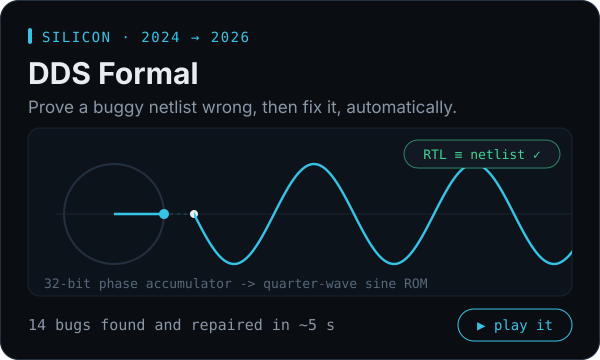</a>
  <a href="https://sundarrajnitish.github.io/Calc-Functional-Verification/"></a>
  <a href="https://sundarrajnitish.github.io/AuctionSystem-Lab/"></a>
  <a href="https://sundarrajnitish.github.io/SoftHub-Lab/"></a>
  <a href="https://sundarrajnitish.github.io/le-crimson-frontend/"></a>

## How I build

| | |
|---|---|
| **Run the real thing** | The demos run the actual code, not a mockup of it. The Calc and mini-MIPS simulators are checked cycle-for-cycle against the RTL, FARM-E and the Hydroponinator run their own firmware against a simulated world, and AuctionHub and SoftHub run their real backend code in your tab. |
| **Every number comes from a command** | The results in these READMEs come from scripts in each repo, mostly using open-source tools and fixed seeds, so anyone can rerun them. |
| **Audit my own past work** | Every rebuild starts by listing what v1 got wrong, from a 2023 design that didn't compile to a gesture pipeline that couldn't keep up with a hand. Where I can, the originals stay in the repo for comparison. |
| **Go one layer deeper** | When the 2024 Calc1 ADD tests failed, I didn't stop at "the design is buggy". I modelled a bridge between the bit-4 and bit-5 nets that reproduces all 3,321 failing lines digit for digit. |

## Right now

- **Specialist, Power Application Engineering @ Schneider Electric**: EPMS and IT/OT integrations for data centres, hospitals, industrial sites and real estate across Eastern Canada.
- **M.Eng, Electrical & Computer Engineering**, Concordia University · **Bachelor's, Mechatronics, Robotics & Automation**, SRMIST
- Heading towards **physical AI and robotics**: bringing power, controls, embedded systems and software together in machines that perceive and act in the real world.

<a href="https://www.linkedin.com/in/sundarrajnitish/">
  
</a>

Every animation on this page is hand-written SVG generated by <a href="scripts/build.py"><code>scripts/build.py</code></a>, with no GIFs and no JavaScript. The header is my first robot, the 2020 <a href="https://github.com/sundarrajnitish/Handwriting-Machine">Handwriting-Machine</a>, plotting my name in the <code>G01</code>/<code>M03</code>/<code>M05</code> dialect its firmware parses.
