<a href="https://sundarrajnitish.github.io/portfolio/">
  
</a>

Hey, I'm **Nitish**. I build across power, electronics, robotics and software. I like figuring out how the pieces fit—then getting the hardware, code and interfaces working together.

Sometimes that's a robot planting seeds. Sometimes it's a processor, a power-monitoring system or a live web app. **Connecting the disciplines is my favourite part.** Lately, that curiosity is pulling me toward robotics and physical AI.


### Built it. Broke it. Figured it out.

A few things I've made, rebuilt and turned into interactive labs. Tap a card and explore.

  <a href="https://sundarrajnitish.github.io/FARM-E-Plantation-Lab/"></a>
  <a href="https://sundarrajnitish.github.io/Automated-Hydroponics-Lab/"></a>
  <a href="https://sundarrajnitish.github.io/RTMC-HG-Lab/"></a>
  <a href="https://sundarrajnitish.github.io/F1-CAN-Telemetry-Lab/"></a>
  <a href="https://sundarrajnitish.github.io/Monte-Carlo-Localization/"></a>
  <a href="https://sundarrajnitish.github.io/mini-MIPS/"></a>
  <a href="https://sundarrajnitish.github.io/Arithmetic-Unit-Lab/"></a>
  <a href="https://sundarrajnitish.github.io/DDS-Synthesizer/">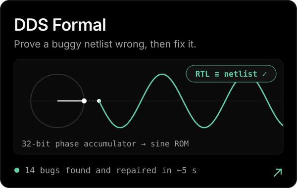</a>
  <a href="https://sundarrajnitish.github.io/Calc-Functional-Verification/"></a>
  <a href="https://sundarrajnitish.github.io/AuctionSystem-Lab/"></a>
  <a href="https://sundarrajnitish.github.io/SoftHub-Lab/"></a>
  <a href="https://sundarrajnitish.github.io/le-crimson-frontend/"></a>


The coursework behind the curiosity

Bachelor's in **Mechatronics Engineering** · Master's in **Electrical & Computer Engineering**

<a href="https://sundarrajnitish.github.io/portfolio/#curriculum">
  
</a>

<a href="https://www.linkedin.com/in/sundarrajnitish/">
  
</a>
